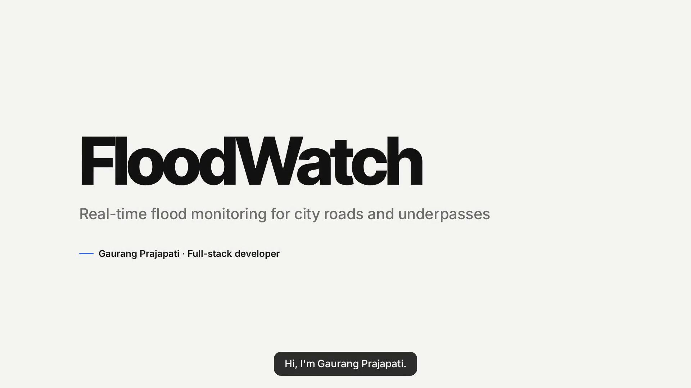
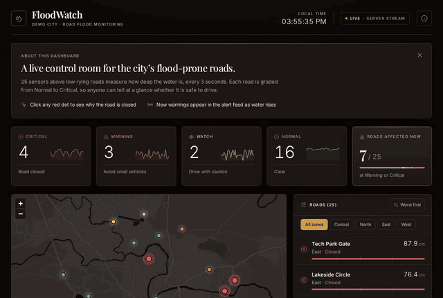
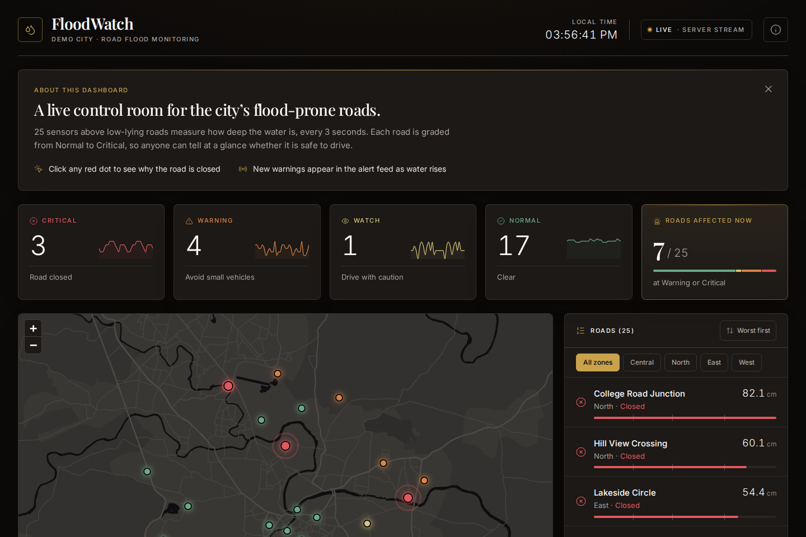
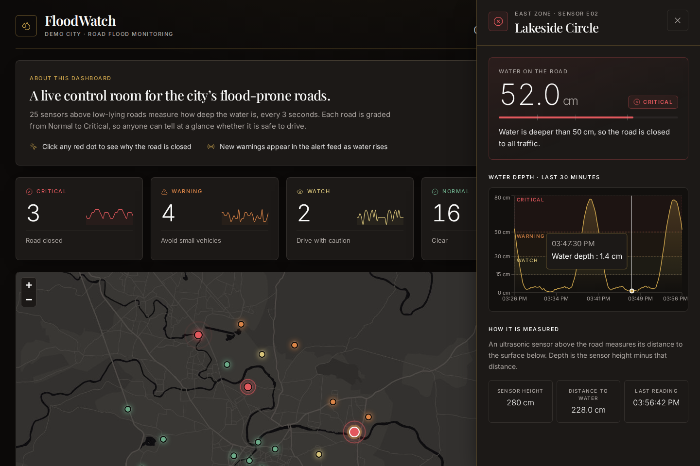
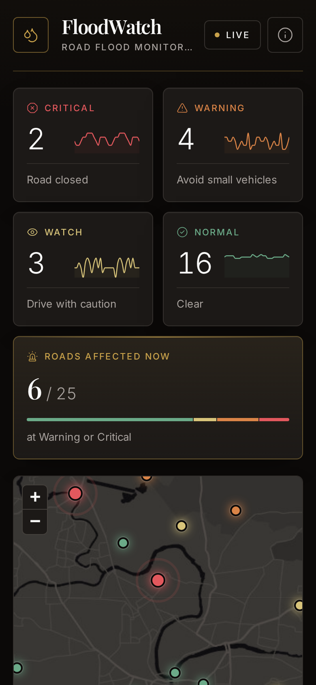

# FloodWatch

A real-time dashboard for monitoring water levels at flood-prone roads and underpasses. This is a portfolio demo with simulated data for a fictional "Demo City".

## Demo

**[Watch the narrated walkthrough (about 4 minutes, with sound and subtitles)](docs/walkthrough.mp4)**: nine short chapters covering every feature (map, road list, road detail, alerts, the offline fallback, the phone layout) and how it is built.

[](docs/walkthrough.mp4)



Full-quality video: [docs/demo.mp4](docs/demo.mp4) ([webm](docs/demo.webm)).

## Screenshots







## Features

- **Control-room look**: dark theme, live clock, Live/Offline badge, and a short "What is this?" intro for first-time visitors (dismissible, reopen with the info button)
- **Live map** of 25 sensor sites (Leaflet + a label-free Esri dark grey basemap, no API key), with markers coloured by severity, pulsing Critical sites, hover tooltips and a legend explaining each colour's road impact
- **Severity levels**: Normal / Watch / Warning / Critical, each mapped to a road impact (Passable → Closed)
- **Road list** sorted worst-first or A to Z, filtered by zone, with a depth gauge per road
- **Alert feed**: an alert is raised when a site rises into Warning or Critical (newest first). It re-arms only after the level drops 5 cm below the threshold, so a reading hovering on a line doesn't spam alerts
- **Site detail drawer** (bottom sheet on phones): current depth with a one-sentence explanation of the status, a 30-minute trend chart with labelled threshold bands, and how the sensor measures depth
- **KPI cards**: roads per severity with a 30-minute sparkline, and how many roads are affected right now
- **Works without the backend**: if the server can't be reached, the browser runs the same simulator ("Offline demo mode" badge)
- Responsive layout, usable on phones

## Tech stack

TypeScript everywhere, with npm workspaces:

| Package   | Stack |
|-----------|-------|
| `shared/` | Sensor model, severity rules, deterministic simulator, Vitest tests |
| `server/` | Node, Express, Socket.IO |
| `client/` | React, Vite, Tailwind CSS, react-leaflet, Recharts, lucide-react, socket.io-client |

## Architecture

```
 shared (model + simulator)
   │                 │
   ▼                 ▼
 server ──Socket.IO "reading" every 3 s──▶ client
   └── REST: /api/sites, /api/sites/:id/history
```

- **Raw distance is the stored truth.** An ultrasonic sensor mounted above the road reports its distance to the water surface. Water level (`mountHeight − distance`) and severity are always derived from it, never stored. This means thresholds or a corrected mount height can change later without rewriting any data.
- **The simulator is stateless.** A reading is a pure function of `(siteId, time)`: seeded sine waves plus a recurring "rain event" with a per-site flood exposure. Zones take turns in the storm cycle and sites are spread out within their zone, so at any moment a few roads are flooded while most are clear (a unit test checks this over two hours). The server and the browser therefore produce identical data without sharing any state, and history is just the same function evaluated over past timestamps.
- Alerts are raised on the client using a pure rule from `shared/` (`nextAlertState`, with hysteresis), so the rule is unit-tested.

## API

| Endpoint | Description |
|----------|-------------|
| `GET /api/sites` | All sites with their current reading |
| `GET /api/sites/:id/history?minutes=30` | Readings at 15 s steps (1–180 minutes) |
| Socket.IO event `reading` | `{ siteId, ts, distanceCm }` for every site, every 3 s |

## Run locally

Requires Node 22+.

```bash
npm install
npm run dev        # server on :4000, client on http://localhost:5173
```

Other scripts: `npm test`, `npm run typecheck`, `npm run build`. The demo video and screenshots in `docs/` are recorded by `scripts/record-demo.mts` (see its header for the one-off Playwright setup); `scripts/shots.mts` refreshes just the screenshots. The narrated walkthrough is recorded by `scripts/record-walkthrough.mts` from the script, feature inventory and chapter plan in `scripts/walkthrough-narration.md` (frame-by-frame on a virtual clock, so it doesn't stutter under load; see the script header).

| Variable | Where | Default |
|----------|-------|---------|
| `PORT` | server | `4000` |
| `CLIENT_ORIGIN` | server (CORS) | `http://localhost:5173` |
| `VITE_SERVER_URL` | client (build time) | `http://localhost:4000` in dev; unset in production means offline demo mode |

## Deploy

**Server → Render** (free web service)
- Root directory: repository root
- Build command: `npm install`
- Start command: `npm start`
- Environment: `CLIENT_ORIGIN=https://<your-app>.vercel.app`. This must match the Vercel URL exactly (scheme included, no trailing slash). Otherwise CORS blocks the socket and the app stays in offline demo mode.

The server runs its TypeScript directly with `tsx`, so there's no separate compile step.

**Client → Vercel**
- Root directory: `client` (framework preset Vite; keep "Include files outside the root directory" on so the `shared` workspace is available)
- Environment: `VITE_SERVER_URL=https://<your-service>.onrender.com`

Without `VITE_SERVER_URL`, the Vercel deploy still works on its own in offline demo mode. Render's free tier sleeps when idle, so the first visit shows offline mode until the server wakes up. The badge switches to "Live server" once the server connects.
